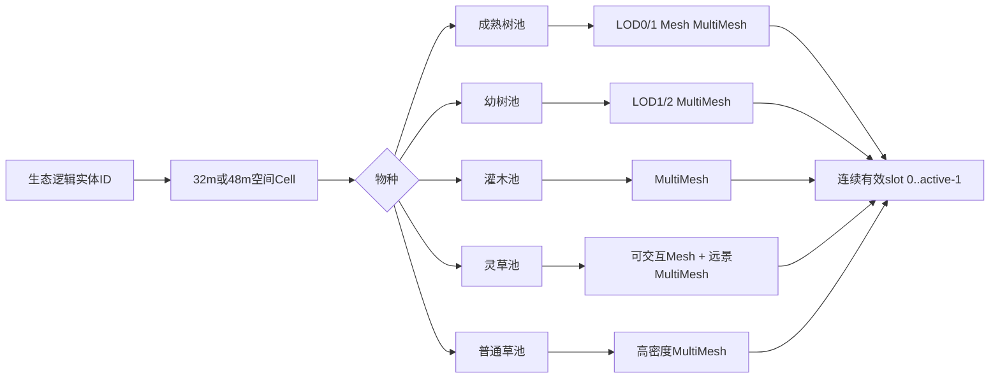
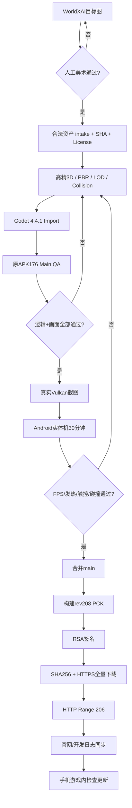

> **规范来源及执行地位**：本文件正文直接保留用户在 2026-10-18 提供的《苍岚·人生世界》高质量美术与生态替换执行报告，作为《苍岚》rev208高质量美术与生态升级的**最高优先级执行依据**；其工作项不得只作为意见、建议或概念图而绕过。执行清单与硬闸门见 [CAC_REV208_HQ_EXECUTION_CHECKLIST_20261018.md](CAC_REV208_HQ_EXECUTION_CHECKLIST_20261018.md)。原上传报告中的 `fileciteturn...` 指其生成时的其他源引用，保留为历史文本，不能当成当前GitHub QA证据；原文里的 `sandbox:` 用户截图引用也只在上传会话有效。
>
> **2026-10-18状态更正（优先于下文历史状态）**：原报告写于 rev208 QA `39064790139` 失败时；随后代码更新，真实 Godot 4.4.1 原APK176 Main QA `39065966234` 已经 **SUCCESS**，新增修士剑击真实死亡/存档和着陆等脚本测试；**但低模人物、树高、灵草辨识度、地表美术仍 FAIL，没有 Android 30分钟真机验证**。rev208 PR #14仍然Draft/未合并/未签名/未发布，正式公网RSA PCK仍是 **rev207**（APK versionCode1176）。本报告里提到的三角数、贴图、FPS、树高等属于**目标预算/验收阈值**，不能当作实际已有资产数据。

---

# 《苍岚·人生世界》高质量美术与生态替换执行报告

## 执行摘要

本轮首先按项目规则核验了正式仓库、正式签名清单、开发日志、rev208 分支和官网，而不是从旧版本重新规划。结论很明确：

**正式可玩的最新签名版本仍是 rev207，不是 rev208。** `android-preview/latest.json` 当前明确记录 `revision: 207`、兼容 `versionCode 1176`、PCK 大小 `35,815,712` 字节、SHA-256 `db64972a0615abbe0600919220398d11853b83cbd4c57121b125f12b10262812`；其说明也明确写着“大世界真实3D旅行、御兽符箓UI与Android实机验收未完成”。fileciteturn15file0

**rev208 现在不能发布。** 当前候选分支是 `feat/rev208-green-kenney-saplings-vegetation`。最新记录显示，第一次真实 Vulkan 画面 QA 因新增树冠挡住第三人称人物而失败；随后虽给出生点和灵根台留下了 8 m/5 m 空地，但最新 Actions `39064790139` 仍在“actual APK176 Main”步骤失败，真正截图步骤因此被跳过。也就是说，rev208 既未完成视觉验收，也未签名发布。fileciteturn21file0 fileciteturn14file0

**你刚才批评的方向是准确的，而且不能再靠调色解决。** 当前主场景代码已经把 `adjustment_saturation` 调到了 `1.30`、`contrast` 调到 `1.095`，太阳还是暖色 `#ffe1b2`、能量 `1.14`；画面仍显得像低模原型，说明核心矛盾已经不是“颜色值不够大”，而是人物模型、树木尺度、植被物种、材质细节、地表分层、动画、光照层次本身不够。fileciteturn25file0

仓库还直接证明了为什么人物会“不像中国古代高精修仙角色”：当前基础人形 `animated_knight.glb` 在 CI 中来自 `game-source/godot3d/assets/free_cc0/quaternius_knight/public/models/knight.glb`；树木则来自 Kenney 的 `tree_oak.glb`。这些资源合法、好用，但**合法不等于能承担高精主角和近景修士**。现阶段它们应被重新定位为远景、凡人、杂役、LOD 或碰撞/逻辑代理，而不再承担近景主视觉。fileciteturn27file0

更重要的是，Quaternius 现在甚至提供了平均约 13k 三角面的 Universal Base Characters、120+ 动作的 Universal Animation Library，以及新一代模块化服饰，但这些仍更适合作为**标准骨架、动画和低中等级角色基础**；主角、核心修士和近镜头宗门人物仍应另做高精国风资产。Quaternius 的动画库明确支持 Godot 并允许 CC0 商用。因此本报告确定新的美术技术路线：

> **WorldXAI负责高质量视觉目标、人物设定、材质参考和统一风格；真正自由第一/第三人称游戏仍使用真实高精3D模型、骨骼、LOD、PBR、碰撞和动画。Kenney/Quaternius不删除，而是降级为远景、杂役、LOD、动画库和临时生态层。近景主角、核心NPC、成熟大树、灵植和核心建筑不允许再呈现明显低模多边形感。**

这也与仓库自己的 WorldX 规范一致：项目早就记录过“单张 WorldX 图不能支持自由第一/第三人称”，必须继续做真实3D结构；但旧 Style Lock 中的“低饱和柔和配色”已经与用户最新要求冲突，应升级为新的 `v2 HQ3D`，而不是继续把旧规则当成最高标准。fileciteturn28file0

还有一个必须同步修的发布问题：**官网当前抓取页面仍显示“更新频道尚未开放”和 rev205，而签名清单已经是 rev207。** 官网自己又声明正式版本应以签名 `latest.json` 为唯一可信来源，因此这里已经存在公开信息不同步，应列入下一次发布门禁。fileciteturn15file0

当前画面可作为本轮“Before”基准：


这张画面后续**不得再作为“美术完成”证据**。它只能作为对照图。最终验收必须让主角、核心 NPC、成熟树木、灵草、矿区妖兽、地表材质在同一个真实 Godot Main 场景中产生明显、肉眼可见的代际提升。

## 现状审计与具体替换对象

项目规范已经明确：50,000 km²、初始 5,000 凡人、约 2.5% 灵根只是**世界数据模型**；不能把所有人口变成同时渲染的 Godot 节点。人族需要出生、死亡、继承、凡人炼体；妖兽需要境界、修炼、繁衍和资源制约；除建筑、道路、水体、裸岩等合理禁种区域外，适宜区域不应长期成为空白纯色地面。fileciteturn0file0

同时，永久 P0/P1 缺陷文档已经要求目标锁定、受击、倒地、死亡/逃跑等真实状态，而不是只有“头上血条”；也要求动画链、背包装备、资源采集、NPC居住、生态再生和修仙法术形成实际循环。这意味着这次美术改造不能只换 GLB，必须与角色死亡、动画、植被生态和资源系统一起打通。fileciteturn1file0

### 当前文件的处理结论

| 当前资产/代码位置 | 当前角色 | 新处理方式 | 优先级 | 完成判定 |
|---|---|---|---|---|
| `res://canglan_rev187/animated_knight.glb` | 基础人形/工人资源；CI来源为 Quaternius Knight | **不得再作为主角/核心修士最终外观**；可保留为凡人护卫、低阶杂役、远景LOD | P0 | 主角近景不再出现该低模轮廓 |
| `cc0_rev206/character_clothing_rig/monk.glb` | 修士服装/角色 | 降级为普通/远景修士；高阶修士换高精国风套装 | P0 | 5–10 m 镜头下核心修士有独立脸、发型、布料和装备 |
| `cc0_rev206/character_clothing_rig/wizard.glb` | 修士/法系模板 | 不再作为中国修仙核心职业造型 | P0 | 核心职业无明显欧美 fantasy wizard 视觉 |
| `res://canglan_rev187/tree_oak.glb` | 当前主树和 rev208 绿植来源 | 保留幼树、远景和LOD；**新增真正成熟大树** | P0 | 主林冠常规高度 8–20 m，明显高于人物 |
| `cc0_spirit/herb/bush.glb` | rev207 曾被大量当作灌木 | **停止当普通绿灌木使用**；重新定义为特殊菌类/灵植 | P0 | 普通森林中不再铺满巨型红白菌体 |
| `flower.glb` / `flower2.glb` / `flower3.glb` / `mushroom.glb` | 灵植 | 保留逻辑ID，但增加高精新视觉变体 | P0 | 灵植与普通地被在轮廓、颜色、尺寸、特效上能快速区分 |
| `cc0_spirit/ore/rock1.glb` / `rock2.glb` | 灵矿视觉 | 保留采矿逻辑，换高精矿石表面和局部灵气特效 | P0 | 不再像单色低模石块，不靠整块强发光识别 |
| `house_1.glb`–`house_4.glb`、`inn.glb`、`gazebo.glb` | 完整CC0建筑 | 短期保留功能；逐步换国风院落/宗门建筑 | P1 | 门窗、内外材质、室内、床位和碰撞真实存在 |
| `wolf.glb` / `fox.glb` / `deer.glb` / `cow.glb` | 四类可见妖兽代理 | 逻辑保留；近景妖兽升级，旧版做低阶/远景族群 | P1 | 近景妖兽有独立皮毛/鳞甲、受击、死亡、攻击动作 |
| `dragon.glb` / `goleling.glb` | 怪物候选 | 不作为最终核心Boss品质 | P1 | Boss必须单独高精化 |
| `materials/rev207/**` | 现有PBR与地表体系 | 保留技术框架，替换源贴图和分层算法 | P0 | 地表不再是大面积单色绿面 |

这些路径和当前 GLB 映射都可以在实际主场景脚本和 rev208 CI 中核对，其中 `tree_oak.glb`、Quaternius Knight 及资源打包位置已经直接写进现有构建工序。fileciteturn11file0 fileciteturn27file0

rev207 的开发日志也已经承认 `bush.glb` 实际呈现为大批红白菌体而不是用户要求的翠绿灌木；rev208 尝试用 Kenney `tree_oak.glb` 的 0.26–0.47 比例幼树替代，但又产生近镜头遮挡。也就是说，继续“把同一棵低模橡树缩放成所有植物”不是最终方案。fileciteturn21file0

### 新的角色品质分层

这里要明确区分**“低多边形技术LOD”**与**“低模美术风格”**。远距离减少三角形是任何移动端游戏都必须做的优化，Godot 官方也推荐远距离使用 Mesh LOD、HLOD 或 impostor；真正禁止的是玩家能够明显看见多边形切面、方块头、块状手脚和简陋树冠。建议品质阶层如下，数字是本项目的**目标预算，不是现有资产实测值**：

| 类别 | LOD0目标 | LOD1目标 | LOD2目标 | 使用距离 |
|---|---:|---:|---:|---|
| 玩家主角 | 120k–180k tris | 60k–90k | 20k–35k | 0–8 m / 8–20 m / 20 m+ |
| 高阶/剧情修士 | 70k–110k | 35k–60k | 15k–25k | 0–10 / 10–25 / 25 m+ |
| 普通修士 | 45k–70k | 25k–40k | 10k–18k | 0–12 / 12–30 / 30 m+ |
| 凡人/杂役 | 25k–45k | 12k–24k | 6k–12k | 近/中/远 |
| 成熟大树 | 18k–40k | 6k–15k | 1.5k–4k | 0–25 / 25–60 / 60 m+ |
| 灌木 | 3k–10k | 1k–3k | billboard/低模 | 0–20 / 20–40 / 40 m+ |
| 灵草 | 2k–8k | 0.8k–2k | impostor | 0–12 / 12–25 / 25 m+ |

Godot 官方指出移动 GPU 对极小屏幕面积内过量几何尤其敏感，骨骼蒙皮、Morph 等还会增加顶点处理成本，因此“120k 主角”可以成立的前提是**屏幕上只有少量近景高模角色，并对远处角色快速进入LOD**，而不是让30个120k角色同时占用近景。人物美术方向也应立即固化：游戏并没有确定唯一历史朝代，因此不要把某一具体朝代服饰冒充考据定论，而是采用“可信中国古代结构 + 修仙幻想”的统一语言。男性核心修士优先束发、发髻、冠/簪/巾体系，女性采用发髻、簪钗等古风结构；禁止继续使用明显西式骑士头、现代短发或通用欧美 wizard 轮廓作为高阶人物。

### NPC“杀不死”必须与美术同步修复

这项不能排到纯美术之后。P0 应直接建立真实状态机：

```text
ALIVE
 ├─ HIT_STAGGER
 ├─ GUARD
 ├─ EVADE
 ├─ DOWNED
 ├─ FLEE
 └─ HP <= 0
       ↓
     DEAD
       ├─ death_animation
       ├─ stop_navigation
       ├─ disable_attack_ai
       ├─ corpse_or_cleanup
       ├─ loot/inventory transfer
       ├─ faction/karma consequence
       └─ world-population/persistence debit
```

这与现有永久缺陷文档要求的“真实受击/倒地/死亡/逃跑”一致；不能再出现 HP 已经打空，但 NPC 仍然站着、继续走路和攻击的情况。fileciteturn1file0

对普通世界人口而言，实体人物死亡还必须同步回 rev207 的地区人口账本，而不能只删除 Mesh；同理，离屏出生/死亡继续由统计模型负责，不应将 5,000 人全部常驻渲染成 Godot 节点。fileciteturn0file0

## 开源资源替换矩阵与WorldXAI美术生产

### 可商用候选资源表

一个重要的研究结论是：**“免费且可商用”与“够高精”是两件事。** Quaternius、Kenney 非常适合动画、原型、远景、NPC族群、道具和生态填充，但它们的大量资源走 stylized/game-ready 路线；如果继续让它们承担主角和近景大树，视觉很难达到你现在要求的层级。Quaternius Universal Base Characters 平均约 13k 三角面，这本身就证明它是很好的标准化游戏基模，但不应该被包装成“顶级近景高模主角”。| 来源/候选 | 许可证 | 三角数 | 纹理分辨率 | PBR贴图 | LOD策略 | 碰撞设置 | 室内/门窗 | Godot适配注意 | 预估替换工作量 |
|---|---|---:|---|---|---|---|---|---|---|
| **当前 Kenney `tree_oak.glb` / Nature Kit** | CC0；Nature Kit 官方列330个文件 | 未指定 | 未指定 | 未指定 | 仅作幼树/LOD2/远景 | 树干 capsule/cylinder | 不适用 | 当前已在PCK管线中稳定使用 fileciteturn27file0 | 低 |
| **Quaternius Stylized Nature MegaKit** | CC0 | 未指定 | 未指定 | 官方仅注明 textured，未指定完整PBR | 作为中远景变体；40树+35植物+27岩石 | 简化凸包/树干柱体 | 不适用 | glTF可直接导入；近景须重新材质化 | 中 |
| **Quaternius Ultimate Stylized Nature** | CC0 | 未指定 | 未指定 | 明确有 seamless textures 与 normal maps | LOD1/LOD2 | 简碰撞 | 不适用 | 可补足树/石/地被多样性 | 中 |
| **Poly Haven PBR地表/树皮** | 全站 CC0 | 不适用 | 原始通常可达8K甚至更高 | Diffuse/Normal/Roughness/AO/ARM/Displacement 等 | 手机导入缩到1K/2K | 地形碰撞独立 | 不适用 | 下载原始高分辨率后离线降采样，不把8K直接塞手机 | 中 |
| **Poly Haven Root Cluster等森林模型** | CC0 | 未指定 | 部分8K源贴图 | 是 | 手工LOD或Godot自动LOD | 简化凸包 | 不适用 | 适合作为近景根系/倒木/森林细节，不宜海量直接实例8K | 中高 |
| **Quaternius Universal Base Characters** | CC0 | **平均约13k** | 未指定 | 未指定 | 可做普通/远景NPC | capsule + bone hitboxes | 不适用 | Humanoid rig，可与Universal Animation重定向 | 中；**不作最终主角** |
| **Quaternius Universal Animation Library** | CC0 | 不适用 | 不适用 | 不适用 | 动画本身可复用 | 不适用 | 不适用 | 120+动作，官方写明已测试Godot；适合作为高精自制人物动画底库 | 中 |
| **Universal Animation Library 2** | CC0 | 不适用 | 不适用 | 不适用 | 不适用 | 不适用 | 不适用 | 130+动画并带3/4段攻击组合，可补战斗动画 | 中 |
| **Quaternius Modular Character Outfits – Fantasy** | CC0 | 未指定 | 3种颜色贴图；具体像素未指定 | 未指定 | 普通NPC使用 | capsule | 不适用 | 12套、62模块；可作骨架/穿戴系统技术验证，最终国风服装仍需重制 | 中 |
| **Quaternius Ultimate Monsters** | CC0 | 未指定 | 未指定 | 未指定 | 妖兽远景/低阶族群 | capsule/convex | 不适用 | 50个已动画怪物；近景核心妖兽仍需二次高精化 | 中 |
| **Quaternius Ultimate Buildings** | CC0 | 未指定 | atlas；具体分辨率未指定 | 未指定 | 建筑远景/HLOD | 静态trimesh+简碰撞 | “完整室内”未指定 | 欧美/通用奇幻视觉明显，不可直接当最终国风宗门 | 中 |
| **Poly Pizza** | **逐模型不同**：可见CC0，也有CC-BY 3.0 | 未指定 | 未指定 | 逐模型核验 | 仅精确选中后制定 | 按模型 | 未指定 | **禁止把整站当CC0**；每个模型ID单独保存作者、许可、SHA | 中 |
| **高精国风主角** | **当前未指定** | 项目目标120k–180k LOD0 | 建议2K主体、局部4K源→手机降采样 | 必须 | 三档手工LOD | capsule+骨骼hitbox | 不适用 | **未发现 Quaternius/Kenney/PolyPizza 中能直接满足“顶级国风近景主角”的现成候选** | 高 |
| **高精国风宗门建筑** | **当前未指定** | 未指定 | 建议1K–2K atlas/模块 | 必须 | HLOD | 静态简化碰撞 | **必须有** | 应以完整3D结构重新制作，而不是AI单张图 | 很高 |

Poly Haven 特别适合解决现在“地面一整片纯绿”和树干没有细节的问题：其 Forest Ground、Leaves Forest Ground、Metasequoia Bark 等资源本身就提供高分辨率扫描式 PBR 数据，而且全站资产为 CC0。手机上不应该直接加载8K，而应该保存8K源文件，在构建时输出1K/2K游戏版本。Poly Pizza 则必须比以前更严格：其合集可以同时出现 CC0 和 CC-BY，因此任何具体模型进入正式仓库前都要记录**页面、作者、模型ID、许可证、原文件SHA256**。不能因为“来自 Poly Pizza”就自动认为全部能无署名商用。### WorldXAI 的正确角色

WorldX 当前本身是一个 MIT 开源的 AI 世界生成/多Agent项目，绘图模块可独立配置图像生成模型；它可以承担风格参考、概念图、材质参考、角色设定和自动视觉审查，但其客户端/生成体系并不等于 Godot 的高精3D模型生产线。项目自己的真实 WorldX batch03 也已经给过一次重要教训：六张1024×1024生成图虽然全部成功生成，但**零件全部“0件生产批准”**，原因包括背景没清掉、随机文字、三视图混在一起、透视不统一等。因此这次必须把“生成成功”和“资产合格”彻底分开。fileciteturn24file0

旧的 `CANGLAN_WORLDX_STYLE_LOCK.md` 还把“低饱和柔和配色”写进了目标；这一条现在必须改，因为与用户最新“颜色更丰富、深绿翠绿墨绿、禁止低模、接近优质国风3D手游”的要求冲突。保留其中“禁止Q版、禁止像素、禁止欧美奇幻、禁止随机文字、真实尺度”的部分，升级为 `v2 HQ3D`。fileciteturn28file0

### WorldXAI人物主角提示词

```text
《苍岚·人生世界》主角高精3D游戏角色设计参考，
中国古代修仙幻想世界，可信中国古代服饰结构，不指定真实朝代，
成年东方男性/女性，正常真实人体比例，约7.5-8头身，
精细面部结构，真实皮肤微细节，细腻眼睛和眉毛，
传统束发、发髻、冠、簪体系，真实发丝与发束，
禁止欧美骑士发型，禁止现代短发，禁止Q版，

服装由丝、麻、锦、皮革、少量金属构件组成，
有真实缝线、织纹、边缘磨损和层叠结构，
修仙服装克制、实用、有身份等级，
武器为中国古风长剑/飞剑，鞘、剑柄、金属材质清晰，

AAA mobile game character reference,
high fidelity realistic stylized 3D,
PBR material reference,
subsurface skin reference,
cloth roughness variation,
hair anisotropy reference,
front view + side view + back view + 3/4 view,
neutral A-pose,
uniform studio lighting,
plain neutral background,
full body visible,
sharp silhouette,
production character sheet,
4K quality reference

NEGATIVE:
low poly, polygon facets, blocky hands, cube head,
western knight, wizard hat, medieval european armor,
chibi, big head, anime 2D flat shading,
pixel art, voxel, plastic skin,
random text, watermark, logo,
cropped hands, cropped feet,
extra fingers, extra limbs, broken anatomy,
heavy bloom, fog covering body
```

**生产规则：**WorldXAI 生成的只是角色美术母版，不能直接宣称“3D主角完成”。后续仍需建模/雕刻 → retopo → UV → PBR → 骨骼 → BlendShape → 动画 → Godot LOD。项目自身 WorldX 规范也明确指出单张图无法承担自由第一/第三人称。fileciteturn28file0

### WorldXAI高精NPC提示词

```text
《苍岚·人生世界》高精修仙NPC角色组，
同一世界统一艺术风格，
中国古代修仙社会，不同年龄、身份、门派和经济阶层，

人物类别：
宗门长老、筑基/结丹修士、炼丹师、符师、炼器师、
御兽师、剑修、体修、商修、散修、世家修士，

每个人面部、体型、年龄、衣着磨损程度不同，
但共用可信东方人体结构和古代发式语言，
核心修士必须比凡人明显精致，
布料层数、腰带、储物袋、法器、身份玉牌均有真实3D结构，

high fidelity game-ready character concept,
realistic stylized PBR,
front / side / back,
clear face and hair,
cloth weave and embroidery visible,
mobile AAA RPG visual target,
no background objects

NEGATIVE:
identical faces, cloned NPC,
low-poly faceted body,
western fantasy wizard,
Q version, cartoon toy,
modern haircut, modern zipper,
flat single-color robe,
random lettering, watermark
```

凡人和杂役可以使用 Quaternius Universal Base Character 或当前低模资源的优化版本，因为官方资源有统一 humanoid rig，便于与动画库衔接；但这应明确标为人物分级，而不是把同样的13k角色复制成“宗主”和“主角”。### WorldXAI成熟大树提示词

```text
高精3D中国山地森林成熟大树设计参考，
自然生长的成年乔木，不是幼树，不是盆景，
总高度10-18米，树干直径0.5-1.3米，
树冠远高于成年人，
真实主干分叉、二级枝、三级枝，
树冠不对称，存在自然缺口，
树皮有裂纹、苔藓、旧伤、颜色差异，
叶片包含深绿、翠绿、墨绿、少量嫩绿，
不是同一种纯绿色，

real-time game tree asset reference,
physically based bark and leaf materials,
front / side / top reference,
individual branch silhouettes,
dense but camera-readable canopy,
subtropical Chinese mountain forest,
high detail near-field LOD0 reference,

NEGATIVE:
tiny tree, sapling only,
low poly ball canopy,
cube leaves, polygon sphere,
perfect symmetrical tree,
red mushroom,
plastic green,
flat single color,
painted background,
text, watermark
```

### WorldXAI灌木与地被提示词

```text
中国山地森林真实灌木和林下地被资产参考，
0.4-1.8米高度，
不同叶片尺寸、枝条角度、密度和绿色层级，
深绿、青绿、翠绿、墨绿自然混合，
地面存在蕨类、苔藓、小草、枯叶、细枝，
不能像红白蘑菇，
不能所有植物共享一个几何轮廓，

isolated vegetation asset reference,
PBR foliage,
realistic translucency reference,
neutral background,
multiple botanical silhouettes,
game-ready atlas reference

NEGATIVE:
giant red mushroom,
identical repeated plant,
low-poly sphere,
empty ground,
neon green,
plastic leaf,
random flower overload
```

### WorldXAI灵草提示词

```text
《苍岚·人生世界》可采集灵草，
真实植物学轮廓 + 修仙世界轻微超自然特征，
株高0.2-0.8米，
叶片、茎、花或果实具有明确识别轮廓，
与普通野草明显不同，
但不要整株像霓虹灯，

灵气只存在于叶脉、花蕊、露珠和极细边缘，
微弱青白/青金/紫青冷光，
自然材质仍占主体，
成熟株与幼株形态不同，
采摘后主体植株继续存在，可重新生长，

isolated PBR plant asset concept,
front side top reference,
subtle emissive mask reference,
botanical realism,
mobile game collectible readability

NEGATIVE:
giant glowing cylinder,
red barrel,
full-body neon bloom,
mushroom unless species specifically mushroom,
same color as grass,
cartoon item icon,
text, UI marker
```

### WorldXAI地表纹理提示词

```text
seamless PBR terrain material reference,
Chinese mountain forest floor,
dense fine grass + dark moist soil + leaf litter + tiny stones + moss,
high-frequency micro detail,
no large flat color blocks,
64-128 visible material details per meter reference,
orthographic top-down material capture,
even neutral lighting,
tileable edges,
albedo reference without baked shadows,
normal/roughness/AO material study,
deep green + emerald + ink green + dark brown soil,
real-world scale

NEGATIVE:
perspective landscape,
big flat green polygon,
cartoon texture,
large pixel mosaic,
painted sunlight,
hard shadow baked into albedo,
text, footprint, object silhouette
```

实际生产材质不建议让生成模型“猜”真实 Normal/ORM；WorldXAI 可以生成视觉参考和 BaseColor 方向，但地面、木材、石材优先直接使用 Poly Haven 一类有真实扫描 PBR 通道的 CC0 源资源，再做色彩统一。Poly Haven 明确提供 Diffuse、Normal、Roughness、AO/ARM、Displacement 等数据。### WorldXAI目标光照场景提示词

```text
third-person Chinese xianxia open-world mobile game target frame,
high fidelity 3D,
camera behind player at human eye-relative third-person height,
35-50mm equivalent natural perspective,

sunlit mountain forest and cultivation village,
warm directional sunlight on sun-facing surfaces,
cool blue-cyan skylight in shadows,
deep green / emerald / ink-green foliage layers,
mature tall trees 10-20 meters,
visible bark, leaf clusters, forest floor,
clear atmospheric depth without white fog washout,
subtle aerial perspective,
strong but soft-contact shadows,
no crushed blacks,
no washed-out highlights,

high quality Chinese 3D mobile RPG,
PBR surfaces,
detailed character,
real cloth and hair,
natural physically plausible scale,

NEGATIVE:
low poly,
voxel,
flat grass plane,
tiny trees,
white haze,
grey washed-out image,
oversaturated neon,
huge bloom,
western medieval village,
pixel art,
concept painting without 3D depth,
UI, text, watermark
```

## Godot落地参数、材质与生态批次

Godot 4.4 官方推荐 glTF 2.0 作为3D导入格式；导入器支持切线、自动LOD、Shadow Mesh、外置材质、物理碰撞生成、动画导入以及提取 glTF 内嵌纹理。带 Normal Map 的模型必须有正确 tangents；静态建筑可使用 Trimesh 碰撞，而动态人物应优先 capsule/primitive 或简化 convex，不能给每个角色套高面数 Trimesh。### 建议Godot导入预设

| 资源 | 导入设置 |
|---|---|
| 主角/高精NPC | `Ensure Tangents=On`；动画 `Import=On`；基线动画30 FPS；Trim和Remove Immutable Tracks开启；纹理Extract到外部；手工LOD优先 |
| 树/灌木/岩石 | `Generate LODs=On`；`Create Shadow Meshes=On`；切线开启；静态碰撞使用手工低模 collider |
| 建筑 | LOD + Shadow Mesh；外置材质；必要时生成Occluder；主体静态trimesh，门窗单独碰撞 |
| 地表PBR | BaseColor sRGB；Normal非sRGB；ORM线性；Mipmaps开启；重复纹理1K/2K |
| 叶片 | Alpha Scissor/Hash，**不要大面积 Alpha Blend** |
| UI | 不跟3D一起降分辨率；保持原生UI分辨率 |

Godot 官方特别指出透明对象通常比 opaque/alpha-tested 更昂贵，而且大量透明叶片容易形成 overdraw；因此树叶应优先 alpha scissor/hash，并尽量把半透明面积压到叶片轮廓附近。### PBR材质节点关系

```text
                    ┌──────────────┐
BaseColor sRGB ────►│ ALBEDO       │
                    │              │
Normal GL ─────────►│ NORMAL_MAP   │
                    │              │
ORM / ARM ──R──────►│ AO           │
          ├─G──────►│ ROUGHNESS    │
          └─B──────►│ METALLIC     │
                    │              │
Detail Normal ─────►│ Detail       │
                    │              │
Vertex Color ──────►│ 微小色差      │
                    └──────────────┘
```

注意 ORM/ARM 通道顺序必须跟**源资源实际定义**一致，不允许假定所有贴图都用同一种通道布局；资产 intake 时要写进 manifest。项目现有美术规范也明确要求保留第三方 UV、Normal、PBR，而不是导入后统一替换成纯色材质。fileciteturn2file0

地表建议改成两层尺度：

```text
WORLD_POSITION.xz
       │
       ├── Macro biome texture  2–8 m 尺度
       │       └── 草/泥/碎石/落叶区域变化
       │
       └── Detail texture       2–8 cm 尺度
               ├── detail albedo
               └── detail normal
                      ↓
             slope + moisture + biome mask
                      ↓
                terrain PBR output
```

这样才符合项目文档定义的“细小、高密度像素纹理”：**近处看得到大量细纹，远处交给 mipmap；不是把整个屏幕渲染成大马赛克。**fileciteturn2file0

### 颜色、光照与雾参数对比

当前真实代码已经是 `saturation=1.30`、`contrast=1.095`、`brightness=0.975`、暖色太阳 `#ffe1b2`、能量 `1.14`、环境光 `0.36`、雾密度 `0.00105`、摄像机 far `450 m`。fileciteturn25file0

因此下一步不要再简单把 saturation 从1.30加到1.5。建议从“真实PBR素材 + 分材质色彩”着手：

| 项目 | 当前 | rev208 HQ建议起点 | 原因 |
|---|---:|---:|---|
| 全局饱和度 | 1.30 | **1.18–1.25** | 真PBR本身已有颜色差异，避免红蘑菇/技能特效一起爆色 |
| 对比度 | 1.095 | **1.06–1.10** | 保留暗部层次，不把人物头发压黑 |
| 亮度 | 0.975 | **0.98–1.00** | 保持接近物理中性 |
| 主光色温 | 当前暖色Hex | **约4800–5200K视觉目标** | 正面暖阳 |
| 天空/阴影色温 | 当前sky ambient | **约7000–8500K视觉目标** | 背面冷色分离 |
| 主光能量 | 1.14 | **1.00–1.15** | 当前并非主要问题 |
| Shadow distance | 48m | 标准45–65m；高档80–120m | 近景树林必须有接触阴影 |
| Shadow bias | 0.055 | **0.025–0.045试验** | 在不产生acne前提下提高接触感 |
| Normal bias | 1.5 | **0.8–1.2试验** | 过大容易让阴影“漂” |
| 雾密度 | 0.00105 | 晴天 **0.00035–0.00065** | 减少洗白；山谷/天气再局部增强 |
| SSAO | 未指定 | **Android Mobile：关闭/不可用**；Forward+截图QA可适量 | Mobile renderer不支持SSAO |

最后一项是引擎能力限制而非审美选择：Godot 4.4 的 **Mobile renderer 不支持 SSAO**，Forward+ 才支持，因此手机正式版不要把SSAO当作画质救命药，应依赖真实 Normal、AO/ORM、接触阴影和材质层次。### MultiMesh资源池重构

当前仓库已经经历过 MultiMesh transform/slot 问题，甚至一度退回“最多约210个真实GLB节点”来避免幽灵实例；而 rev206 又曾出现树木批次/实例槽位不足。这说明 rev208 不应该简单“把池子数字再扩大一点”。fileciteturn11file0

正确方案是按**空间格子 + 物种 + LOD**管理：



Godot 官方说明 MultiMesh 可以非常低开销地绘制成千上万个相同物体，但整个 MultiMesh 是一个空间批次；如果把整个世界的草塞进单一 MultiMesh，会导致可见性和剔除粒度变差。因此必须拆成小区域池。建议初始池容量：

| 每Cell资源 | 目标活跃数 | 预留slot | 溢出处理 |
|---|---:|---:|---|
| 成熟树 | 12–24 | 32 | 建第二page |
| 幼树 | 20–40 | 48/64 | 建第二page |
| 灌木 | 40–80 | 96/128 | 建第二page |
| 灵草 | 8–24 | 32 | 交互近景单体+远景池 |
| 草簇 | 160–400 | 256/512 | 多page |
| 石块/倒木 | 16–32 | 48 | 建第二page |

删除实例时不要把 slot 的 Transform 写成零缩放来“隐藏”，而应采用**swap-remove**：

```text
删除 slot K
↓
把最后一个 active slot N 的实例复制到 K
↓
更新 entity_id → slot 映射
↓
active_count -= 1
↓
visible_instance_count = active_count
```

这可以同时解决“空slot出现在原点”“池容量和实体数不一致”“可见实例中夹着无效Transform”等问题。项目过去的 MultiMesh 幽灵/IDENTITY transform 问题说明，正式QA必须直接验证每一个 active slot 的 world transform，而不仅验证数组长度。fileciteturn19file0

### 植物覆盖规则

生态系统不要再理解成“铺满同一种草”。正确的是：

```text
建筑/道路/水体/裸岩/新挖地 → 禁种或特殊覆盖
森林适生区 → 大树 + 小树 + 灌木 + 蕨 + 草 + 苔 + 枯叶
草甸 → 高草 + 低草 + 野花 + 局部裸土
灵矿 → 稀草 + 岩石 + 矿脉植物 + 妖兽活动痕迹
河岸 → 湿地草 + 芦苇 + 苔藓 + 河卵石
宗门 → 人工药园 + 修剪植被 + 石路 + 建筑留空
```

这既满足“不要有空白”的要求，又不会产生树林长在屋顶、道路、水里和矿坑里的问题。项目最高规则本身也规定了建筑、石路、水体、裸岩等例外，并要求种子库不能因为库存归零导致整个世界物种灭绝。fileciteturn0file0

## 性能预算与Android实机策略

Godot Mobile renderer 的定位就是移动平台；相比 Forward+ 特效少、基础成本更低。Godot 同时支持把3D分辨率单独降低而保持2D UI原生分辨率，这一点尤其适合当前项目，因为现有代码本身已经采用独立 SubViewport 只缩放3D画面。fileciteturn25file0

例如1080p下，Godot官方给出的3D缩放结果是：1.0 为2.07MP，0.85约1.50MP，0.75约1.17MP，0.67约0.93MP。也就是说，把3D从1.0降到0.85已经能明显减少GPU像素工作，而不必降低UI分辨率。### 推荐三档正式画质

| 项目 | 极致 | 高 | 标准 |
|---|---:|---:|---:|
| 3D scale | 1.0 / 0.90 | **0.85** | **0.67–0.75** |
| 目标FPS | 60 | 45/60自适应 | 30/45 |
| 近景高精NPC | 8–12 | 6–8 | 4–6 |
| 成熟树有效距离 | 100–140m | 70–100m | 50–70m |
| 高质量动态阴影 | 80–120m | 45–65m | 30–45m |
| 草密度 | 100% | 70–80% | 45–60% |
| 灵草完整模型距离 | 30m | 22m | 15m |
| 远处人物动画更新 | 15–20Hz | 10–15Hz | 5–10Hz |
| AO | PBR纹理/Baked | PBR纹理/Baked | PBR纹理/Baked |

### 每帧预算

以下是**项目建议预算，不是Godot硬上限**：

| 指标 | 极致目标 | 高档目标 | 标准目标 |
|---|---:|---:|---:|
| 可见三角面 | 1.8–2.8M | 1.2–2.0M | 0.7–1.2M |
| Draw Calls | <350 | <280 | <200 |
| 近景Skinned角色 | ≤12 | ≤8 | ≤6 |
| 动态投影角色 | ≤8 | ≤6 | ≤4 |
| 活跃植被碰撞体 | 100–160 | 70–120 | 50–80 |
| 目标GPU frame time @60 | <16.7 ms | <16.7/22.2 ms | <22.2/33.3 ms |
| 游戏资源常驻内存目标 | 600–900MB | 450–700MB | 350–550MB |

真正决定手机是否能跑的不是“总共仓库有多少三角形”，而是**这一帧镜头里实际提交多少几何、透明叶片、Skinned Mesh、阴影和材质切换**。Godot 官方也建议远景LOD、减少透明过绘、控制骨骼蒙皮，并针对大世界按区块加载。### 纹理内存策略

Godot 4.4 在 Mobile/Forward+ 上的高质量VRAM压缩可使用移动端 ASTC；默认移动压缩则可使用 ETC2。官方还特别提醒移动 GPU 一般不要依赖超过4096×4096的纹理。因此源文件和游戏文件分开：

| 资产 | 美术源 | Android游戏版本 |
|---|---:|---:|
| 主角脸/身体 | 4K | 2K |
| 主角衣物 | 4K | 2K |
| 头发 | 2K–4K | 1K–2K |
| 核心NPC | 2K–4K | 1K–2K |
| 树干/叶片atlas | 4K–8K | 1K–2K |
| 地表单材质 | 4K–8K | 1K |
| 建筑模块 | 4K源 | 1K–2K atlas |
| 普通NPC | 2K | 512–1K |

**不要因为 Poly Haven 提供8K就把8K直接塞进PCK。** 其8K是源素材优势，最终手游版应保留源文件追溯，同时构建手机纹理。### 发热和持续帧率

手机性能不能只跑30秒截图。Android 官方明确提供 Thermal API/ADPF 来让游戏根据热状态动态降低分辨率、阴影、效果或帧率；`PowerManager` 区分 NONE、LIGHT、MODERATE、SEVERE、CRITICAL 等热状态，其中 SEVERE 已意味着体验受到明显影响。因此实机验收改为：

**冷机起测 → 进入密林 → 城镇 → 灵矿妖兽战斗 → 御剑高速移动 → 回城 → 持续30分钟。**

正式通过条件建议：

- 高端目标机前10分钟60 FPS，30分钟后仍不得长期跌到30以下；
- 中档机允许45/30自适应，但帧间隔应稳定；
- 30分钟内不允许持续进入 `THERMAL_STATUS_SEVERE`；
- 如果进入 MODERATE，自动先降低草密度、阴影距离和3D scale，而不是先砍主角人物贴图；
- 每一档都记录平均FPS、1% low、GPU frame time、CPU frame time、热状态和内存峰值。

Android 官方的实际大型游戏案例也表明，持续高画质而不做自适应会触发热降频；根据热余量动态调分辨率、阴影等更有利于维持稳定帧率。GPU瓶颈应使用 Android Performance Analyzer/Frame Profiler 或系统分析工具观察真实 frame pass、Vulkan调用和GPU时间，而不是只凭“手机摸起来还好”。## QA验收与发布门禁

### P0验收清单

| P0任务 | 必须完成 | 失败即不得发布 |
|---|---|---|
| **高精主角** | 新主角脸、头发、身体、服装、剑；3种镜头可看；无明显多边形块面 | 仍使用 `animated_knight.glb` 作为主角近景 |
| **核心NPC** | 至少4种高精修士模板；脸、头发、衣服明显区分 | 宗主/长老与杂役同一低模 |
| **成熟森林** | 至少3种成熟乔木+2幼树+4灌木/地被；树明显高于人 | 树都只有1–3m、同一模型缩放 |
| **地表PBR** | 草/土/石/落叶微细纹理，坡度/湿度分层 | 大片纯色绿平面 |
| **灵草识别** | 5–8种不同轮廓；幼株/成熟株；微弱而非整株霓虹 | 灵草与普通草无区别 |
| **NPC死亡** | HP→0后死亡动作、AI停止、持久化人口变化 | HP0仍站立/攻击 |
| **战斗反馈** | 受击、硬直、倒地/死亡、攻击判定与镜头 | 只有数字减血 |
| **摄像机遮挡** | 树冠/屋顶遮挡时透明或镜头拉近处理 | 再次出现rev208树叶把玩家完全挡住 |
| **Mobile性能** | 30min持续测试，三档可调 | 只跑Linux截图 |
| **正式Godot截图** | 至少6张实际Main截图 | WorldX图冒充游戏截图 |
| **发布同步** | manifest、官网、更新日志一致 | 官网仍显示旧rev205 |

永久缺陷文档本来就要求真正 Godot 4.4.1 解析、原 Main QA、真实引擎图片和手机实测分开标记；RSA、SHA256、HTTPS Range 206 都必须过关后才能发布。fileciteturn1file0

### 必须提交的截图证据

至少应有以下真实 Godot 截图，并在文件名里直接写 `real_godot`，避免和 WorldX 概念图混淆：

```text
real_godot_rev208_hq_player_close_front.png
real_godot_rev208_hq_player_back_hair_cloth.png
real_godot_rev208_hq_cultivator_npc_close.png
real_godot_rev208_mature_dense_forest.png
real_godot_rev208_spirit_herb_vs_ground.png
real_godot_rev208_mine_beast_guard_combat.png
real_godot_rev208_npc_death_state.png
real_android_rev208_30min_forest_device.png
```

其中前三张必须能看见人物脸、发型和衣料；森林图必须能同时看见玩家作为尺度参照；灵草图必须把普通地被和灵植放在同一画面；战斗图必须显示真实敌人血量变化；死亡图必须显示死亡后的状态而不是调试文本。

### 美术量化门禁

不要用“感觉好一点了”验收。建议建立以下自动/人工混合门槛：

**人物：**
主角近景镜头占屏幕高度≥40%时，脸、头发、衣料和武器必须仍有细节；手部不能是块状几何；发型不得为明显欧美骑士/现代造型。

**森林：**
100 m可视范围内至少存在成熟乔木、小树、灌木、地被四层；出生区可以留出合理林间空地，但“空地”必须仍有草、碎石、枯叶或泥土材质，而不是一整块纯绿平面。

**灵植：**
玩家在6–10 m距离不依靠名字标签，也应至少能区分“普通草”和“可采灵草”。

**建筑：**
可进入建筑必须有门洞、室内地面、墙体内侧和碰撞；“外壳模型能进门但里面全空/穿墙”不能通过。

**NPC死亡：**
连续攻击同一可杀NPC直至HP=0，必须在同一运行实例看到状态切换；存档重载后不能无理由满血复活。若游戏设计规定某些关键NPC不死，则必须有明确“不可杀”身份规则，而不能所有人都默认无敌。

### P1验收

P1 再推进：宗门大殿/功法阁/丹房/药园/洞府完整室内；核心妖兽高精化；儿童/青年/老年外形变化；季节植被；宗门制服系统；布料/头发次级动画；远景山体/水体；御兽、符箓、炼丹和炼器职业的真实操作界面。

Quaternius 的动画库可以显著降低动作覆盖成本，因为其库已经包含多方向移动、跑步、游泳、坐姿、死亡和战斗等动作，并声明 Godot 兼容；最适合用来支撑“高精自制人形 + 开源动作库”的组合。### 正式发布门禁



这条链路符合项目自己的最高发布规则：只有真正 Godot 原 Main、PCK、签名、公网校验和真实发布都完成以后才能说“更新进游戏”；手机实机仍只能在真实手机验收后标绿。fileciteturn0file0

## 最终执行清单与里程碑

### 立即执行的P0顺序

**第一阶段：冻结错误资产用法。**

立即停止把 `bush.glb` 当森林通用灌木；停止继续通过缩放 `tree_oak.glb` 来冒充完整森林；`animated_knight.glb` 不再作为主角最终角色。保留它们的逻辑、碰撞和历史兼容路径，避免破坏存档。当前文件映射已经由主脚本和CI固定，可安全从“视觉角色”层解耦，而不是删掉逻辑ID。fileciteturn11file0turn27file0

**第二阶段：先做一名真正高精主角。**

不要同时做20个人。先把一名主角做到合格：头、脸、头发、身体、服装、飞剑、Idle、8向移动、跑、跳、普攻、受击、死亡/倒地、御剑。WorldXAI先生产四视图和材质母版，再落到真实GLB。

**第三阶段：成熟森林替换。**

先做3种成熟大树 + 2种幼树 + 4种灌木 + 4种草/蕨，配合 Poly Haven 的土壤、树皮、落叶PBR。Kenney树只做幼树/远景。Quaternius Nature包可补远景物种，不再当近景最终画质。Kenney Nature Kit 是CC0；Quaternius Stylized Nature MegaKit也明确为CC0，可安全做生态补充。**第四阶段：灵草和灵矿重制。**

13处资源逻辑保持不动，只替换视觉；灵草库存为0时保留活植株状态；灵矿附近保留境界妖兽生态。rev207现有世界逻辑已经验证了500区域、5000人口、妖兽繁衍修炼、草木种子库等逻辑，不应因美术重制倒退。fileciteturn15file0

**第五阶段：NPC死亡和战斗闭环。**

在主角美术完成后立刻把死亡动画接入 HP 状态机，修掉“杀不死”。永久P0文档已经把真实受击、倒地、死亡/逃跑列为验收要求。fileciteturn1file0

**第六阶段：才做全景调色。**

等新PBR资产进入后再调整 saturation/contrast/fog。因为当前已经是 1.30 saturation，再继续增加只会让红菌、UI和特效更刺眼，并不能让树皮、衣料和地表凭空长出细节。当前代码参数有明确记录。fileciteturn25file0

### Git与实际Godot执行步骤

继续当前候选，不从 rev204/rev205 重来：

```bash
git fetch origin
git switch feat/rev208-green-kenney-saplings-vegetation
git pull --ff-only origin feat/rev208-green-kenney-saplings-vegetation
git status
git rev-parse HEAD
```

当前分支最后记录的文档提交是 `e025ef371c53c9c5d94c3ba70fd460d7c66a6d24`，其父提交包含出生林间空地修复；分支本身仍未发布。fileciteturn12file0turn21file0

新增正式高精资产建议统一放置：

```text
game-source/apk176-ota177-candidate/assets/hq-rev208/
├── characters/
│   ├── player/
│   ├── cultivators/
│   └── mortals/
├── vegetation/
│   ├── trees/
│   ├── shrubs/
│   ├── groundcover/
│   └── spirit_herbs/
├── terrain/
│   ├── grass/
│   ├── soil/
│   ├── rock/
│   └── leaf_litter/
├── beasts/
├── buildings/
└── provenance/
```

每个资产都要同时登记：

```text
source_name
source_author
source_url_or_asset_id
license
original_sha256
converted_sha256
triangle_lod0
triangle_lod1
triangle_lod2
texture_resolution
material_channels
collision_type
godot_import_notes
```

对于仓库里目前没有的数据，**必须写“未指定”而不是猜数字**。

主原场景候选路径已经存在：

```text
game-source/apk176-ota177-candidate/scenes/main_original_quality_rev187.tscn
```

而 `scenes/main.tscn.remap` 仍承担原APK资源映射关系，因此真正验证必须走原APK176 fixture，而不是单独搭一个新的展示场景。fileciteturn26file0

现有 CI 已经公开了 Godot 4.4.1 的真实构建方式，可直接复用：

```bash
GODOT=/tmp/Godot_v4.4.1-stable_linux.x86_64

$GODOT --headless --editor \
  --path logic-qa \
  --import

$GODOT --headless \
  --path logic-qa \
  --script res://tools/build_apk176_quality_rev187.gd

python3 tools/verify_apk176_rev187_3d_pck.py \
  qa-results/canglan-apk176-rev187-3d-UNSIGNED.pck

CANGLAN_QA_PCK_PATH="$PWD/qa-results/canglan-apk176-rev187-3d-UNSIGNED.pck" \
$GODOT --headless \
  --path logic-qa/apk176-export-fixture \
  --script res://verify_original_main_quality_rev187.gd
```

这些并不是臆造命令，而是 rev208 当前 Actions 工作流正在实际使用的构建和 Main QA 路径。fileciteturn27file0

通过后再提交：

```bash
git add \
  game-source/apk176-ota177-candidate/assets/hq-rev208 \
  game-source/apk176-ota177-candidate/scripts \
  game-source/apk176-ota177-candidate/materials \
  logic-qa \
  docs

git commit -m "feat(rev208): replace near-field low-poly art with HQ PBR characters and ecology"
git push origin feat/rev208-green-kenney-saplings-vegetation
```

现有 QA 工作流：

```text
.github/workflows/canglan-rev208-green-saplings-qa-only.yml
```

当前工作流明确只做 QA、并且最后一次真实执行仍失败，因此在它重新全绿之前不得创建正式签名发布。fileciteturn18file0turn14file0

### 签名和PCK流程

当且仅当：

```text
高精人物 PASS
森林 PASS
灵草 PASS
NPC死亡 PASS
原Main PASS
真实Godot截图 PASS
Android实机 PASS
```

全部完成后，才从现有正式发布工序派生：

```text
.github/workflows/canglan-original-apk176-rev207-signed.yml
        ↓
.github/workflows/canglan-original-apk176-rev208-signed.yml
```

**不能直接把 rev207 文件名改一下就运行。** 必须审查其中所有硬编码的 `207`、PCK文件名、manifest revision、SHA、发布说明和兼容版本，确保不会覆盖历史不可变PCK。当前仓库确实存在 rev207 正式签名工作流以及独立公网 RSA/SHA256/HTTP206 proof workflow。fileciteturn23file1turn22file1

签名私钥继续只存在 Actions Secret；不得写入仓库、日志、PCK、官网或本地公开产物。项目仓库自身的发布规则也明确把密钥和玩家存档排除在公共站点之外。最终发布对象应为：

```text
android-preview/canglan-content-rev-208.pck
android-preview/latest.json
```

验收顺序：

```bash
# 概念示意，具体签名脚本继续复用正式CI
sha256sum android-preview/canglan-content-rev-208.pck

# CI内用项目正式RSA公钥验签
# 不在终端输出私钥

# 发布后重新从公网完整下载
# 比对 bytes / SHA256 / RSA

# 再发 Range 请求，必须真实得到 HTTP 206
```

rev207 已经采用相同原则完成 RSA、SHA256、完整公网下载和 Range206 见证，因此 rev208 不需要另造一套更新机制。fileciteturn15file0turn22file1

### Android实机测试步骤

正式手机验收必须从已经安装的 APK176 开始，不能拿Linux Vulkan截图代替：

```text
启动原APK176
→ 确认当前正式rev207
→ 保存旧档备份
→ 游戏内检查更新
→ 下载候选/正式rev208 PCK
→ 验签成功
→ 不清档进入世界
```

然后依次执行：

```text
主角近景旋转360°
第一/第三人称切换
跑步、跳跃、攻击、受击
树林连续穿行
树冠遮挡镜头
灵草采摘→库存变化→再生
灵矿采矿→妖兽战斗
杀死普通NPC→保存→重载
御剑起飞→森林上空→降落
进入建筑→室内→出门
30分钟连续游玩
```

记录：

```text
device model
Android version
SoC/GPU
render resolution scale
quality preset
average FPS
1% low FPS
max memory
thermal status
time-to-MODERATE
是否到SEVERE
battery/thermal change
touch conflict
camera clipping
crash count
```

只有真实手机跑过以后，才允许在 `docs/CAC_CHANGELOG.md` 中把 **Android实机** 从 `PENDING` 改成 `PASS`。这也是现有项目规则明确要求的发布语义。fileciteturn0file0

### 分阶段里程碑

| 里程碑 | 内容 | 出口条件 |
|---|---|---|
| **HQ-Art-Lock** | WorldXAI v2视觉基准、人物四视图、森林、灵草、光照 | 目标图人工通过；旧“低饱和”规则被新规范取代 |
| **HQ-Character** | 主角 + 4核心修士 + 新发型 + 动画 | Godot近景截图通过，无可见低模块面 |
| **HQ-Ecology** | 成熟树、灌木、地被、灵草、PBR地表 | 林层完整，树高合理，空白地面消失 |
| **Combat-Life** | NPC受击、死亡、人口账本、妖兽死亡 | NPC可真正死亡并保存 |
| **World-PBR** | 建筑、矿物、灵草、森林统一材质 | 不再依靠纯色和全局饱和度 |
| **Mobile-Sustain** | 三档画质、LOD、MultiMesh、热适配 | 30分钟手机测试不过热崩帧 |
| **REV208-RC** | 原APK176 Main全QA、真实截图 | 所有自动+人工P0全绿 |
| **REV208-SIGNED** | RSA PCK、Pages、SHA、Range206、官网同步 | 手机能在原游戏内下载并运行 |

**当前应停在 `HQ-Art-Lock → HQ-Character → HQ-Ecology`，而不是继续把现有 Kenney 幼树修到勉强不挡脸就直接签 rev208。** 最新 rev208 CI 已经用真实失败证明了“技术上是真GLB”并不等于“美术上达到要求”。fileciteturn21file0turn14file0

最终验收标准只有一句：

> **玩家打开原《苍岚·人生世界》以后，不看版本号、不看调试文字，仅凭实际画面就能明显判断：这已经不是截图里那套低模占位人、矮小树、红白菌灌木和纯绿地面的版本；而是人物、森林、灵植、材质、战斗死亡和生态层级都真正换代的3D修仙世界。**

在达到这条标准之前，rev208 应继续保持**候选、未签名、未发布**状态。