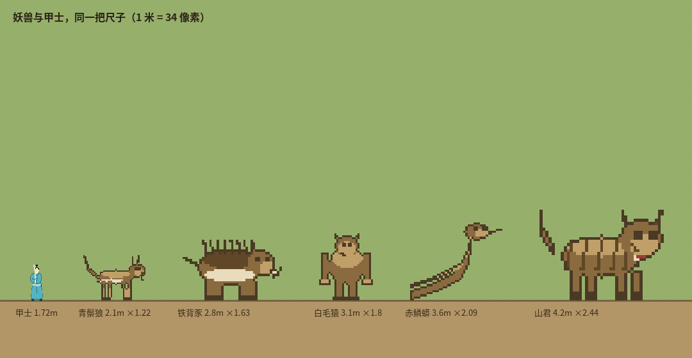

# 妖兽重画：不再是褐色团块

上一版的“妖兽”是用椭圆堆出来的示意图，被指出来太敷衍。这一版按游戏里的画法重画：**48×48 像素格、硬边描边、每个物种一张**，和地图、卡牌同一支笔。

## 一、五张画

| 妖兽 | 画法要点 | 身高 |
|---|---|---|
| 青鬃狼 | 细腰长腿、前后腿错开走位、竖耳、蓬尾、舌 | 2.1 m |
| 铁背豕 | 粗筒身、短腿、八根背刺、鼻盘、两根獠牙 | 2.8 m |
| 白毛猿 | 直立、长臂及地、宽肩、浅色胸毛与面盘 | 3.1 m |
| 赤鳞蟒 | S 形长身、抬头、分叉信子、七点鳞纹、背光高光 | 3.6 m |
| 山君 | 厚身、大猫头、五道虎纹、耳内暗色、口部浅色 | 4.2 m |

技术做法：`content/beastart.mjs` 里一个 `Canvas` 提供 `rect / ell / line`，每个物种一个绘制函数，最后统一跑一遍 **outline()**——凡紧贴空白的像素压成墨色 `#4a3a24`，所以轮廓硬、和地图建筑是同一种边缘。

## 二、和甲士站一起（同一把尺子）

甲士 1.72 m，狼 2.1、豕 2.8、猿 3.1、蟒 3.6、山君 4.2——真正的差距是 1.2 到 2.4 倍人高，不是“随便画个大一点”。

## 三、进游戏的地方

- 地图：`beastArtSVG()` 出的是 SVG，可以直接当卡片背景（`sheet-beast` 用 contain 居中，不像建筑那样铺满）。
- 卡片：`cardView()` 新增 `beast` 字段，名字命中「青鬃狼/铁背豕/白毛猿/赤鳞蟒/山君」就换成妖兽画；
- 战斗：`asFighter()` 给血 4 倍、伤害约 3.4 倍、体型 1.2–2.4 倍。

## 四、验收

- `node --test tests/*.test.mjs` → **213/213**
- 新增 2 项：五张画各自不同且有内容（实心像素 > 250）、妖兽卡能带出对应画。

## 五、还没做

- 只有侧身像，没有朝向与行走帧；也没做「受伤/扑咬」两帧。
- 妖兽还没在世界里生成：现在只有画和数值，没有巢穴、出没、袭击村落、掉落。
- 描边只有一层，远处缩小会糊成黑块，需要在 LOD 里降级为纯色剪影。
